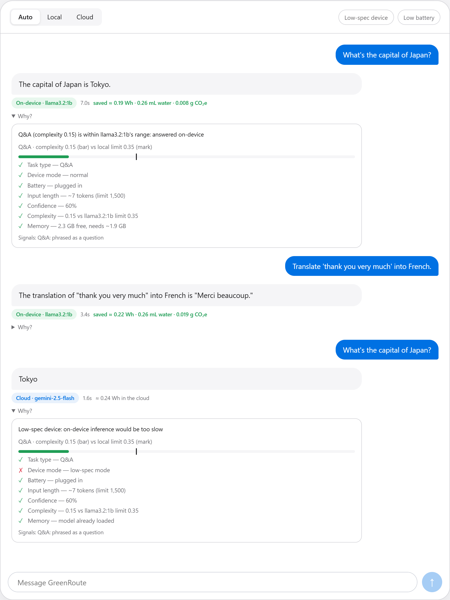
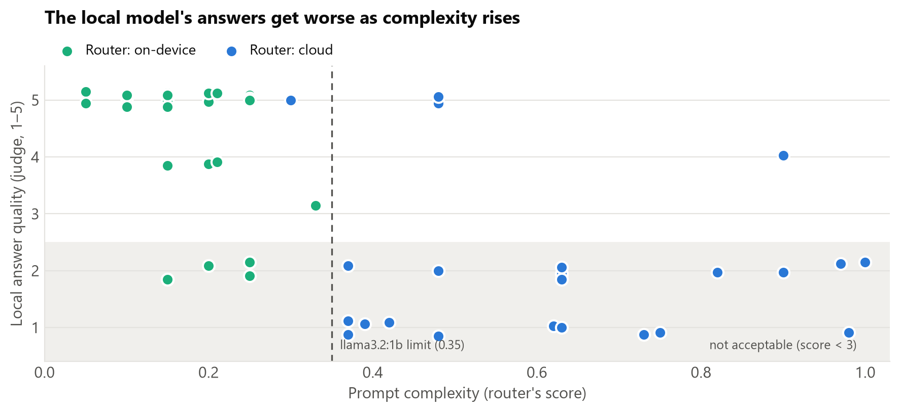
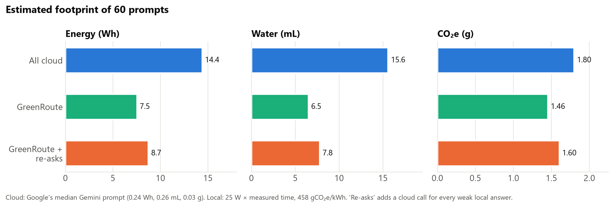
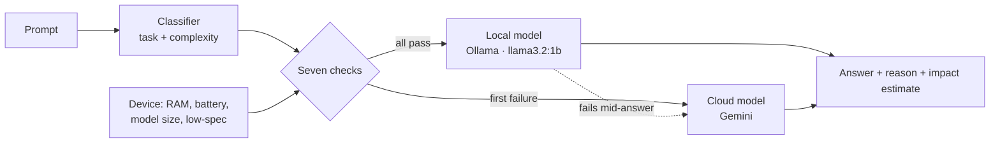

# GreenRoute

**A local-first AI router.** GreenRoute sits between an app and its AI backend and asks a question
other LLM routers skip: *does this request need to leave the device at all?* Simple requests are
answered by a small model on your own machine; demanding ones go to the cloud. Every answer shows
where it ran, why, and an estimate of the energy and water it saved.

[](https://github.com/ironman2cool/Powered_by_caffeine/actions/workflows/tests.yml)




## Results

A 60-prompt benchmark of everyday requests, hand-labelled before running, with `llama3.2:1b` on a
laptop (Intel Core i5-1135G7, 12 GB RAM, no GPU). Every prompt was also answered by the local model
*and* a larger cloud model (Gemma 4 26B), which then judged the local answer from 1 to 5.

| | Result |
|---|---|
| Kept on-device | 35 of 60 prompts (58%) |
| Agreement with the hand labels | 57 of 60 (95%); all 3 misses erred toward the cloud |
| Local answers judged acceptable, prompts **kept on-device** | 30 of 35 (86%), mean 4.4 / 5 |
| Local answers judged acceptable, prompts **sent to the cloud** | 4 of 23 (17%), mean 2.0 / 5 |
| Estimated saving vs all-cloud | **48% energy, 58% water, 19% CO₂e** |
| …if every weak local answer were re-asked in the cloud | 39% energy, 50% water, 11% CO₂e |
| Local latency (median / 90th percentile) | 4.4 s / 12.8 s |
| Device power above which local stops saving energy | ~136 W |





Full tables: [`benchmark/results/summary.md`](backend/benchmark/results/summary.md). Every prompt,
answer and judge verdict: [`results.jsonl`](backend/benchmark/results/results.jsonl).
Write-up: [`docs/article.md`](docs/article.md).

## Why

Routers like OpenRouter or NotDiamond pick *which cloud model* gives the best quality per dollar.
None of them ask whether the request should go to a data center in the first place. Small
on-device models (Llama 3.2 1B/3B, Phi-4-mini, Gemma) now handle a large share of everyday
requests — quick facts, short rewrites, translations, classifications — so sending everything to
the cloud by default wastes energy and water for no gain.

## Features

- **Rules-based router** — classifies each prompt (12 task types + a 0–1 complexity score), then
  runs seven checks: task type, device mode, battery, input length, confidence, complexity vs the
  local model's size, and free memory. The first failed check becomes the human-readable reason.
- **Real local inference** with [Ollama](https://ollama.com); **cloud fallback** with Google Gemini
  (free tier), with automatic fallback across models when one runs out of free quota.
- **Never a dead end** — if the local model is missing or crashes mid-answer, the request moves
  to the cloud and the user is told why.
- **Streaming chat UI** with a live route preview while you type, a "Why?" panel per answer, and
  demo toggles for a low-spec device and a low battery.
- **Impact estimates** per answer and running totals (energy, water, CO₂e) from cited public
  figures — net of the local device's own electricity use.
- **Guided setup** — detects your hardware, recommends a model size, and offers to install Ollama,
  start it, or download a model, from the page or the terminal.
- **Benchmark** of 60 labelled prompts with real models and an LLM judge, plus 63 tests in CI.

## How it works



| Check | Sends to cloud when… |
|---|---|
| Task type | it's an image request (a local text model can't draw) |
| Device mode | the device is flagged low-spec |
| Battery | the battery is under 20% and unplugged |
| Input length | the prompt is over ~1,500 tokens (slow on laptop CPUs) |
| Confidence | the request can't be classified |
| Complexity | the score exceeds the local model's limit (0.35 for ~1B, 0.5 for ~3B, 0.6 for ~7B) |
| Memory | there isn't enough free RAM to load the model |

The classifier is deliberately simple: keyword and pattern rules, length cues ("1500 words",
"5 paragraphs", "in detail") and input size. It runs in well under a millisecond, has no
dependencies, and every decision can be explained.

## Impact estimates

| | Per request | Source |
|---|---|---|
| Cloud | 0.24 Wh, 0.26 mL water, 0.03 g CO₂e | Median Gemini Apps text prompt, [Google, Aug 2025](https://cloud.google.com/blog/products/infrastructure/measuring-the-environmental-impact-of-ai-inference) ([paper](https://arxiv.org/abs/2508.15734)) |
| Local | device watts × measured generation time; CO₂e at your grid's intensity; no cooling water | Grid default 458 gCO₂/kWh, world average 2025 ([Ember via Our World in Data](https://ourworldindata.org/grapher/carbon-intensity-electricity)) |

Savings are `cloud baseline − actual`, so a slow local answer on a power-hungry machine shows up as
a *negative* saving. These are estimates, not measurements: Google's figure is a median for its
own traffic, and the local side depends on `DEVICE_ACTIVE_WATTS` (default 25 W, a laptop CPU).
Water used by power plants is excluded on both sides.

## Quick start

You need **Python 3.10+** and a free **Gemini API key** from <https://aistudio.google.com/apikey>.
Ollama is optional: without it, everything routes to the cloud.

**Windows:** double-click `backend/start.bat`.
**macOS / Linux:** `./backend/start.sh`.

Both scripts create a virtual environment, install dependencies, ask for your key, check your
device for local AI, and start the server at <http://localhost:8000> (API docs at `/docs`).

To run a local model: install [Ollama](https://ollama.com/download), then either accept the offer
in the chat or run `ollama pull llama3.2:1b`.

## API

| Endpoint | Does |
|---|---|
| `POST /chat/stream` | Route and answer, streamed as NDJSON events: `decision`, `token`…, `fallback`/`note`, `done` |
| `POST /chat` | Route and answer in one JSON response |
| `POST /route` | Routing decision only, with the classification and every check |
| `GET /stats`, `POST /stats/reset` | Running totals, sources and assumptions |
| `GET /setup` | Device specs, recommended model, local status |
| `POST /local/pull`, `GET /local/pull`, `POST /local/use` | Download or switch the local model |

Request body for chat/route: `{"prompt": "...", "route": "auto|local|cloud", "device": {"low_spec": true, "battery_pct": 12, "on_battery": true}}`
(`device` is optional and overrides the server's own readings).

## Configuration

Settings live in `backend/.env` (see [`.env.example`](backend/.env.example)).

| Setting | Default | Meaning |
|---|---|---|
| `LOCAL_MODEL` | `llama3.2:1b` | Ollama model |
| `CLOUD_MODEL` | `gemini-2.5-flash` | Primary cloud model |
| `CLOUD_FALLBACK_MODELS` | `gemini-3.5-flash-lite,gemini-flash-lite-latest,gemma-4-26b-a4b-it` | Tried in order when a model is out of quota or overloaded |
| `LOCAL_UNAVAILABLE` | `cloud` | No local model → `cloud` (with notice), `simulate`, or `error` |
| `LOCAL_MAX_INPUT_TOKENS` | `1500` | Longer prompts go to the cloud |
| `LOW_BATTERY_PCT` | `20` | Offload below this battery level when unplugged |
| `DEVICE_ACTIVE_WATTS` | `25` | Extra power your device draws while generating |
| `GRID_GCO2_PER_KWH` | `458` | Your grid's carbon intensity |

## Development

```bash
cd backend
pip install -r requirements-dev.txt
python -m pytest -q                      # 63 tests, no models or network needed
python -m benchmark.run_benchmark        # real benchmark (needs Ollama + a Gemini key)
python -m benchmark.summarize            # tables in benchmark/results/, charts in docs/images/
```

```
backend/
  app.py            FastAPI app: chat (streamed), routing, stats, setup endpoints
  router.py         the seven checks and the decision
  classifier.py     task type + complexity rules
  metrics.py        energy / water / CO2e estimates and running totals
  local_backend.py  Ollama client          cloud_backend.py  Gemini client with fallback chain
  system_check.py   hardware + Ollama detection        model_manager.py  background model downloads
  setup_local.py    terminal setup wizard  static/index.html  the whole UI (no build step)
  benchmark/        60 labelled prompts, runner, summary + charts
  tests/            pytest suite
```

## Limitations

- The classifier is rules-based: it misses phrasing it has no rule for, and it errs toward the
  cloud when unsure. A small learned classifier is the obvious next step.
- Impact figures are estimates built from a published median and an assumed device power draw.
- On a laptop CPU, a 1B model is often *slower* than a fast cloud model; the case for local is
  energy, water, privacy and offline use, not speed.
- The judge in the benchmark is itself an LLM, and the labels were made by one person.

## License

MIT © 2026 Akshay Rao. Started as a hackathon prototype and rebuilt from the ground up.
